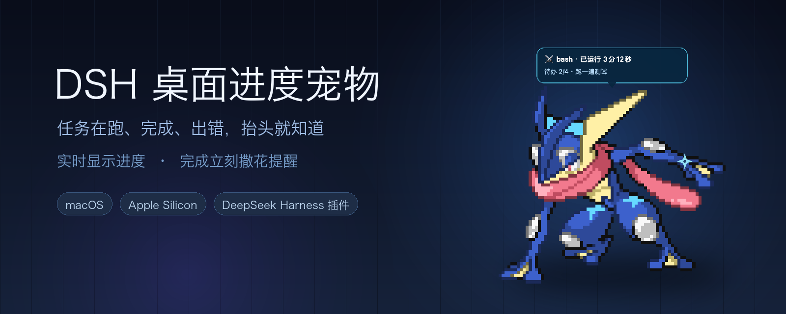
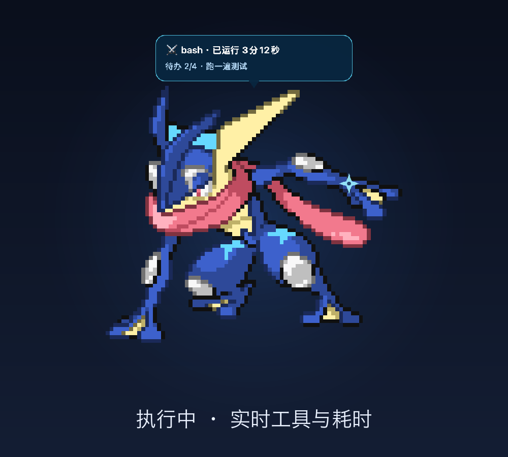
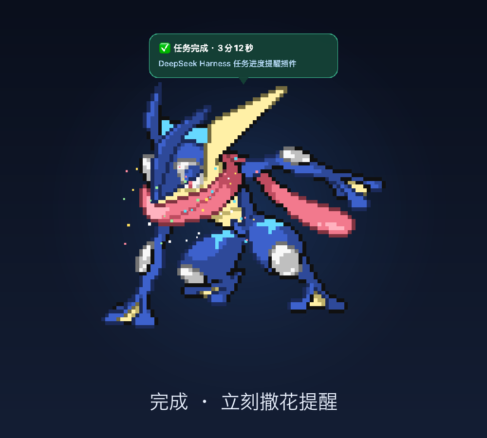
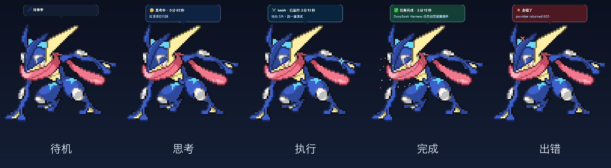
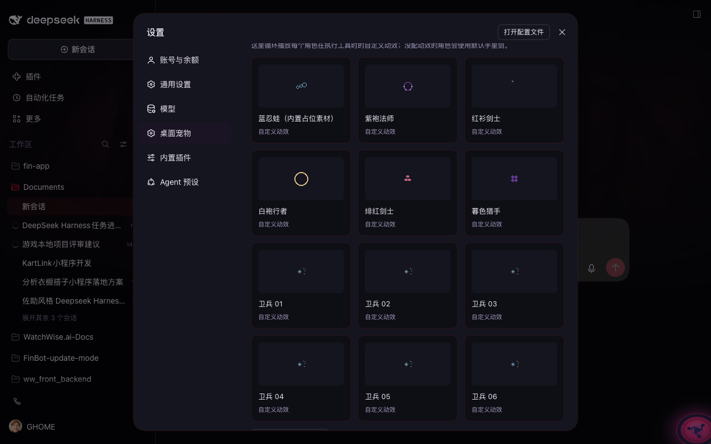

# dsh-task-pet · DSH 桌面进度宠物

一只**浮在所有窗口最上方**的像素桌宠，用来做一件事：**实时告诉你 DSH 任务跑到哪了、什么时候结束**。

不用一直盯着 DSH，也不用开系统通知权限：任务在思考、跑工具、写回答、完成、出错时，宠物会实时换动作；任务一结束立刻撒花（可选提示音），完成气泡默认停留 6 秒。

> 核心定位是**进度提醒**：状态跟着任务实时变化，不是定时弹提醒。



<p align="center">
  
  
</p>



> 截图中的甲贺忍蛙为**个人自用素材**（`skins/` 不随仓库分发）；仓库内置的 11 个角色均为 CC0，可直接使用与分发。

## 它解决什么问题

- 你去别的窗口干活时，抬头就能看到 DSH 还在不在跑任务；
- 任务完成 / 失败 / 中断**立刻**知道，不用切回来刷新；
- 宠物不抢键盘焦点、透明区域点击穿透，不挡你操作；
- 只在 DSH 开着时出现，DSH 退出宠物自动消失，不会留孤儿进程。

## 功能

- **实时进度**：从 DSH 已提交的会话事件折叠出 turn / tool / todo / title 状态，350ms 轮询本地回环，不读取消息正文。
- **完成即提醒**：turn 结束立刻跳跃撒花（可选音效），完成气泡默认 6 秒，可在设置里调。
- **独立设置页**：设置 → **桌面宠物**（和「模型」「账号与余额」并列），可换角色、调大小、静音、改气泡时长，保存只重启宠物、**不重启 DSH 会话**。
- **11 个内置角色**：6 个卫兵 + 5 个像素角色，全是 CC0 授权、可放心分发；首次启动自动复制到角色目录。
- **自定义角色 + 自定义动效**：用户可以放自己的角色，也可以让自己的 AI 生成角色和动效；设置页有「动效展示」循环播放每个角色的动效。
- **桌面交互**：拖动移动、滚轮缩放、单击唤回 DSH、右键菜单（大小/移动/静音/隐藏/退出）。
- **隐私**：状态只在本机回环（127.0.0.1 + 随机 token），设置接口走 DSH 连接鉴权，不上传任何对话内容。

## 安装（macOS Apple Silicon）

前置：macOS 13+、Apple Silicon、Xcode / Command Line Tools（编译原生宠物需要 Swift）。

```bash
git clone https://github.com/GHOOOME/dsh-task-pet.git
cd dsh-greninja-pet

# 仓库已带 arm64 构建；改过 pet/main.swift 才需要重新编译
./pet/build.sh

# 安装到 DSH profile（任选其一）
# a) 在 DSH 里让 AI 调用 plugin_manager：
#    install_bundle target=/绝对路径/dsh-greninja-pet
# b) 命令行（dsh 是 DSH 自带 CLI）：
dsh plugin --profile desktop add link:$PWD
```

安装或更新后，**完整退出并重启一次 DSH 桌面端**（浏览器端模块需要重新加载，只刷新页面不够）。重启不会丢会话，宠物会自动回来。

安装后检查：

- 设置里出现「桌面宠物」页 = 已生效；
- `~/.dsh/dsh-task-pet/settings.json`（偏好）、`bridge.json`（端口/token）；
- 宠物没出现：`ps aux | grep dsh-task-pet`，或临时用 `DSH_TASK_PET_DISABLE=1` 启动 DSH 排查。

> 目前只支持 macOS Apple Silicon；Windows / Linux / Intel Mac 暂无宠物窗口（Host 侧桥接仍可运行）。npm 暂未发布，安装走 GitHub + 本地路径。

## 使用

### 打开设置

DSH 右上角账号菜单 → **设置** → 左侧 **桌面宠物**。里面有：

| 区块 | 作用 |
| --- | --- |
| 我的角色 | 已安装角色 + 预览，点击选择 |
| 动效展示 | 循环播放每个角色的自定义动效 |
| 显示与提醒 | 角色大小 1–6×、完成提示音开关、完成气泡停留秒数 |
| 添加自己的角色 | 角色目录、复制 AI 指令、打开 OpenGameArt / 国内可访问素材索引、在 Finder 打开目录 |



改完点「保存并应用」：只重启宠物进程（约 1 秒），正在跑的任务和对话都不受影响。

### 桌面交互

| 操作 | 效果 |
| --- | --- |
| 拖动宠物 | 移动位置，自动记住（重启恢复、多屏校正） |
| 在宠物上滚轮 / 双指上下滑 | 逐级缩放 1–6× |
| 单击 | 把 DSH 唤到前台 |
| 右键 | 大小 / 移动 / 复位位置 / 静音 / 隐藏 15 分钟 / 退出 |
| 双指捏合 | macOS 只把 magnify 派给激活窗口，非激活浮层通常收不到；用滚轮或菜单缩放 |

透明像素区域点击穿透，不会挡住底下应用的按钮。

### 状态与提醒

| 状态 | 触发 | 表现 |
| --- | --- | --- |
| 待机 | 没有运行中的 turn | 呼吸浮动，不显示气泡 |
| 思考 | turn 开始且无工具 | 轻晃 + 思考小点 |
| 执行 | tool/call | 快速摆动 + 旋转手里剑（或角色自带动效），气泡显示工具名、实时耗时、待办进度 |
| 写回答 | assistant/message | 轻微浮动 |
| 完成 | turn 正常结束 | 跳跃 + 撒花 + 可选提示音，气泡 6 秒后收起 |
| 出错 | turn 出错 | 抖动 + 红叉 |
| 中断 | 用户取消 | 抖动 + 黄色"已停止" |
| 打盹 | 10 分钟无活动 | Zzz |
| 断线 | Host 关闭 | 变灰，10 秒后退出 |

## 自定义角色

角色 = 一个文件夹，放在 `~/.dsh/dsh-task-pet/characters/<id>/`：

```
my-pet/
  skin.json
  idle.png
  working.png
  win1.png win2.png ...
  msg.mp3
```

```jsonc
{
  "name": "我的宠物",
  "author": "你的名字",
  "license": "CC0",
  "states": {
    "idle":     { "sprite": "idle.png" },
    "thinking": { "sprite": "idle.png" },
    "working":  { "sprite": "working.png" },
    "success":  { "frames": ["win1.png", "win2.png"], "fps": 10, "sound": "msg.mp3" },
    "error":    { "sprite": "working.png" }
    // 没配的状态回退到 idle；thinking/streaming/aborted/sleep/disconnected 都可以单独配
  }
}
```

- 图片用透明 PNG 像素图；App 用最近邻整数倍放大，保持锐利；
- 路径必须在角色文件夹内（Host 会拒绝越界路径和逃逸符号链接）；
- 音效只在该状态进入时播放，支持 mp3 / wav 等；
- 放好后在设置页点「刷新角色列表」→ 选中 → 保存。

### 自定义动效（每个状态一套）

角色不只可以换图，还可以给状态配自己的动效（不写就用默认特效）：

```jsonc
{
  "effects": {
    "working": { "frames": ["fx_0.png","fx_1.png"], "fps": 10, "anchor": "right", "scale": 1.5 },
    "success": { "builtin": "confetti" },
    "thinking": { "builtin": "none" }
  }
}
```

- 优先级：自定义 `frames` > 显式 `builtin` > 默认特效；
- `builtin` 可选 `shuriken` / `dots` / `confetti` / `zzz` / `cross` / `none`；
- `anchor`：`right`（默认）/`left`/`above`/`below`/`center`；`scale` 是像素倍率倍数；`offset` 是相对角色的像素偏移；
- 示例：[examples/custom-effects](examples/custom-effects)。

### 让 AI 帮你做角色 / 动效

设置页有两个复制按钮，把指令粘给你的 AI 即可：

- **复制 AI 生成指令**：在角色目录生成一套原创像素角色（含 `skin.json`）；
- **复制 AI 动效生成指令**：为已有角色生成 `fx_*.png` 动效帧并写进 `effects`；
- 也有**复制给 AI 的安装指令**，用于安装网上找到的 CC0 素材。

**素材版权请自行确认**：只使用 CC0/CC-BY 或你拥有权利的内容，并在 `skin.json` 写明 `author`/`license`。仓库自带的 11 个角色全部是 CC0（来源见 [pet/characters/ATTRIBUTION.md](pet/characters/ATTRIBUTION.md)）。

## 工作方式与隐私

```
DSH Host
  └─ dsh-task-pet（index.js）
       ├─ 只读监听 session/event、agent/status（绝不 resume Agent）
       ├─ 回环 HTTP 状态桥（127.0.0.1 + 随机 token）
       ├─ 设置 API /api/dsh-task-pet/*（DSH 连接鉴权）
       └─ 拉起原生宠物进程，插件卸载时结束
              ▲ 350ms 轮询
  dsh-task-pet（macOS AppKit，bin/ 下）
```

- 不读取消息正文、不外发数据、不需要系统通知权限；
- 设置接口只允许同源/已配对浏览器访问，角色预览和动效帧都做路径穿越校验。

## 常见问题

- **装了没反应**：完整退出并重启 DSH；确认设置里出现「桌面宠物」。
- **宠物不出现**：`ps aux | grep dsh-task-pet`；`~/.dsh/dsh-task-pet/pet.log` 有启动/交互日志；可用 `DSH_TASK_PET_DISABLE=1` 临时禁用。
- **改了不生效**：浏览器端模块需要重启 DSH 才载入；角色/动效文件刷新列表即可。
- **只想要提醒、不要桌宠**：宠物只在 DSH 开着时出现，退出 DSH 即消失；也可以右键退出宠物。

## 开发

```bash
npm test            # 16 项：事件折叠 + 设置存储/校验/并发/路径穿越 + 角色播种
./pet/build.sh      # 重新编译原生宠物
```

目录：`index.js`（Host 桥接）、`lib/`（折叠/设置/API）、`client.js`（设置页）、`pet/main.swift`（原生宠物）、`pet/characters/`（内置角色）、`examples/`（示例）。

## 许可

代码 MIT，版权归 GHOOOME；内置角色来自 OpenGameArt，按各自 **CC0** 分发（见 ATTRIBUTION 与各角色 `SOURCE.md`）。`skins/` 是个人自用素材，不随仓库分发，也不在 MIT 授权范围内。
