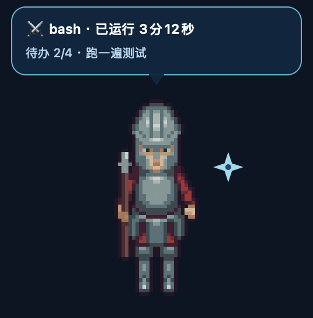
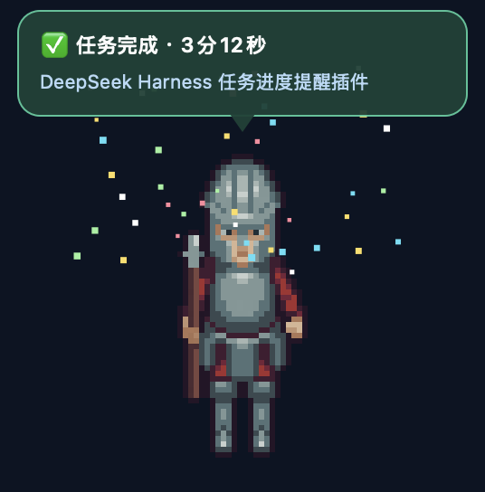
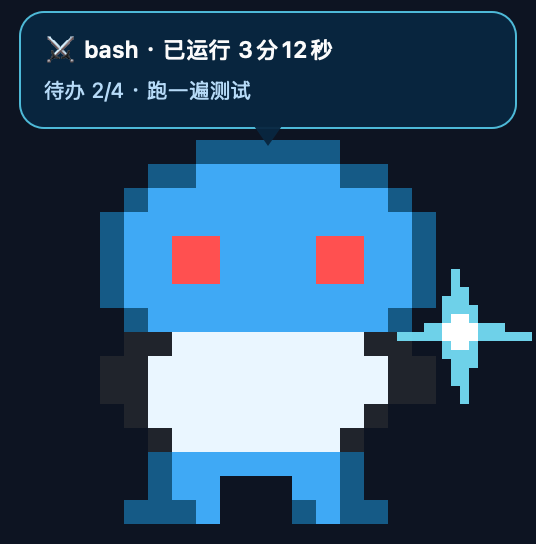

# dsh-task-pet

给 DeepSeek Harness 用的桌面宠物：一只**浮在所有窗口最上层**的像素角色，实时显示当前任务在做什么（思考 / 跑工具 / 写回答 / 完成 / 出错），任务一结束立刻撒花 + 提示音。

角色不绑定某一只宠物：任何人都可以放入自己的像素角色，也可以让 AI 生成后按皮肤格式导入。




## 功能

- **实时状态**：从 Host 已提交的会话事件（`session/event`）折叠出 turn / tool / todo / title 状态，350ms 轮询本地回环；不读取消息正文。
- **完成即提醒**：turn 结束立刻跳跃撒花（可选提示音），完成气泡默认停留 6 秒，可在设置里调。
- **独立设置页**：设置 → **桌面宠物**（与「模型」「账号与余额」并列），可切换角色、调大小、静音、设置完成气泡时长；保存只重启宠物进程，**不重启 DSH 会话**。
- **内置角色**：6 个 CC0 授权的像素卫兵（OpenGameArt *Town Guards Vol.1*），首次启动自动复制到角色目录；用户角色放在 `~/.dsh/dsh-task-pet/characters/<id>/`，支持每个状态单独配图、逐帧动画、单独音效。
- **桌面交互**：拖动移动、滚轮/双指滑动缩放、单击唤回 DSH、右键菜单（大小 / 移动 / 静音 / 隐藏 / 退出）。
- **不抢焦点**：非激活浮动面板 + 透明区域点击穿透；点宠物不会把键盘焦点从 DSH 抢走。
- **隐私**：宠物状态只在本机回环传递（127.0.0.1 + 随机 token），设置接口走 DSH 自身连接鉴权，不上传任何对话内容。

## 安装

前置：macOS 13+、Apple Silicon、Xcode / Command Line Tools（编译原生宠物需要 Swift）。

```bash
git clone <this-repo> dsh-task-pet
cd dsh-task-pet

# 1. 编译原生宠物（仓库已带 arm64 构建；改过 pet/main.swift 才需要重编）
./pet/build.sh

# 2. 安装到 DSH profile（任选其一）
#    a) 在 DSH 里让 AI 调用 plugin_manager：
#       install_bundle target=/绝对路径/dsh-task-pet
#    b) 命令行：
dsh plugin --profile desktop add link:/绝对路径/dsh-task-pet
```

安装或更新后，**完整退出并重启一次 DSH 桌面端**，浏览器端模块才会载入（只刷新页面不够）。重启不会丢会话，宠物会自动回来。

安装后检查：

- 设置里出现「桌面宠物」页 = 已生效；
- `~/.dsh/dsh-task-pet/bridge.json`（端口 / token，权限 600）；
- `~/.dsh/dsh-task-pet/settings.json`（偏好）；
- 若宠物没出现：`ps aux | grep dsh-task-pet`，或临时用 `DSH_TASK_PET_DISABLE=1` 启动 DSH 排查。

## 内置角色

仓库自带 **11 个 CC0（公共领域）角色**，放在 `pet/characters/`，首次启动时自动复制到 `~/.dsh/dsh-task-pet/characters/`（已存在的目录不会被覆盖，方便用户改图）：

| id | 名称 | 来源（均为 OpenGameArt，CC0 1.0） |
| --- | --- | --- |
| `guard-01` … `guard-06` | 卫兵 01–06 | [Town Guards Vol.1](https://opengameart.org/content/town-guards-vol1-%E2%80%94-5-characters-down-direction-sample-64px) |
| `a-zelda-boy-1` | 红衫剑士 | [ArMM1998 — Zelda-like tilesets and sprites](https://opengameart.org/content/zelda-like-tilesets-and-sprites) |
| `a-necromancer-2` | 紫袍法师 | [Disthron — Mr. Necromancer Man](https://opengameart.org/content/mr-necromancer-man-animated) |
| `b-fumiko-fencer` | 绯红剑士 | [skoam — Fumiko Complete Charset](https://opengameart.org/content/fumiko-complete-charset) |
| `b-ars-notoria-monk` | 白袍行者 | [Balmer — Hero spritesheets (Ars Notoria)](https://opengameart.org/content/hero-spritesheets-ars-notoria) |
| `b-gothic-hunter` | 暮色猎手 | [ansimuz — Gothicvania Cemetery Pack](https://opengameart.org/content/gothicvania-cemetery-pack) |

每个内置角色还自带**主题动效**（卫兵火花/碎石、剑士斩击、法师符文、剑士花瓣、武僧冲击环、猎手暗影、占位蛙泡泡），配置就在各自 `skin.json` 的 `effects` 字段里，可直接改。

完整来源与提取说明见 [pet/characters/ATTRIBUTION.md](pet/characters/ATTRIBUTION.md) 及各角色目录下的 `SOURCE.md`。

也可以继续使用内置的原创占位蛙（`pet/assets`，id 为 `default`）。

## 角色格式

一个角色就是一个文件夹：

```
~/.dsh/dsh-task-pet/characters/my-pet/
  skin.json
  idle.png
  working.png
  win1.png win2.png ...
  msg.mp3
```

```jsonc
{
  "name": "我的宠物",
  "author": "你的名字",
  "license": "CC0",
  "states": {
    "idle":     { "sprite": "idle.png" },
    "thinking": { "sprite": "idle.png" },
    "working":  { "sprite": "working.png" },
    "success":  { "frames": ["win1.png", "win2.png"], "fps": 10, "sound": "msg.mp3" },
    "error":    { "sprite": "working.png" }
    // 未配置的状态回退到 idle；thinking/streaming/aborted/sleep/disconnected 都可以单独配
  }
}
```

- 图片用透明 PNG 像素图；App 用最近邻整数倍放大，保持像素锐利。
- 文件路径必须留在角色文件夹内（Host 会拒绝越界路径和逃逸符号链接）。
- 音效只在该状态进入时播放，支持 mp3 / wav 等。
- 放好文件夹后，在设置页点「刷新角色列表」→ 选中 → 保存。

### 自定义动效（effects）



角色不只可以换图，还可以给每个状态配自己的动效（不写就用默认特效，老版本会忽略这个字段）：

```jsonc
{
  "effects": {
    // 用自定义帧动画：frames + fps，anchor 决定相对角色的位置
    "working": { "frames": ["sparkle_0.png", "sparkle_1.png"], "fps": 10,
                 "anchor": "right", "scale": 1.5, "offset": [2, 0] },
    // 改用内置特效
    "success": { "builtin": "confetti" },
    // 关掉某个状态的特效
    "thinking": { "builtin": "none" }
  }
}
```

- 优先级：自定义 `frames` > 显式 `builtin` > 默认特效。
- `builtin` 可选：`shuriken`（手里剑）、`dots`（思考点）、`confetti`（撒花）、`zzz`（打盹）、`cross`（错误叉）、`none`。
- `anchor`：`right`（默认）、`left`、`above`、`below`、`center`；`scale` 是相对像素倍率的倍数；`offset` 是相对角色的像素偏移。
- 动效帧同样必须是角色文件夹内的 PNG，建议透明背景，循环播放。
- 完整示例：[examples/custom-effects/](examples/custom-effects/)（原创 MIT 素材）。

> 动效由宠物程序渲染，不是图片序列本身；所以任何角色都能用同一套配置。

桌面端右键菜单里的 **获取宠物素材** 可以打开素材站、复制"给 AI 的安装指令"；把指令粘给 Agent，它就能按上面格式帮你装角色。

### 素材站怎么选

插件默认链接的是 [OpenGameArt](https://opengameart.org/)（国外，CC0/CC-BY 游戏素材）和 [Kenney](https://kenney.nl/assets)（国外，CC0）。**这两个都是境外站点，国内网络下不保证稳定可用**（实测 OpenGameArt 可打开但较慢；Kenney 可能被反爬；itch.io 经常超时）。所以设置页同时提供「复制 AI 生成指令」——让 AI 用生图模型或 Python/Pillow 在本机生成角色，完全不依赖外网。**不要**用 The Spriters Resource、PokéDB Sprites 这类拆包游戏素材站来制作要分发的角色——它们托管的是版权作品，公开推荐或再分发有侵权风险。

关于"只放链接"是否侵权：单纯链接到网站首页通常不构成复制或传播作品，但如果明知站点内容是盗用素材、还引导用户下载，存在"帮助侵权"的风险，开源项目里公开推荐也不合适。所以默认只放授权清晰的站点。

国内素材站（爱给网、千图等）并非专门面向游戏像素角色，且免费区授权条款各不相同，使用前必须逐个确认是否允许再分发；没有确认前不要放进角色包或公开推荐。

**素材版权由角色作者自行负责**：只使用 CC0/CC-BY 或你拥有权利的图片和音效，并在 `skin.json` 的 `author` / `license` 字段写清楚。

### 国内可访问性

实测（本机、未走代理）：OpenGameArt 可打开但约 2–3 秒；Kenney 可能被反爬；itch.io 经常超时。国内可访问的替代入口：

| 站点 | 情况 | 是否适合 |
| --- | --- | --- |
| [Godot Lab 素材索引](https://godotlab.org/assets) | 中文、约 1 秒可访问，按 CC0/商用标注整理 | 可作"找素材"的索引；素材多外链 GitHub/网盘，**下载前逐条核对许可** |
| 爱给网 / 千图 / 觅知 | 国内可访问 | 授权通常只允许设计用途，**不允许把素材打包再分发**，不适合随插件分发 |
| iconfont | 国内可访问 | 图标库，不是像素角色素材 |
| Pixor | 付费"3D 模型转像素精灵表"工具 | 不是素材站，且非国内 |

结论：**严格满足"国内 + 专做像素角色 + 明确允许再分发"的站目前没找到**。所以默认方案是 AI 本地生成或用户自备素材；设置页另提供 Godot Lab 索引作为可访问的参考入口。

网络受限时推荐顺序：① AI 本地生成 → ② 本机已有素材 → ③ 能访问的 CC0/CC-BY 素材站。素材站只是可选入口，不是必需步骤。

## 设置页

「桌面宠物」页包含：

| 区块 | 内容 |
| --- | --- |
| 我的角色 | 已安装角色列表 + 预览图，点击选择 |
| 显示与提醒 | 角色大小（1–6×）、完成提示音开关、完成气泡停留秒数 |
| 添加自己的角色 | 角色目录路径、复制给 AI 的安装指令、打开 OpenGameArt、在 Finder 打开角色目录 |
| 状态 | 宠物是否运行、当前平台、启动错误 |

保存会短暂重启宠物（约 1 秒），DSH 会话、对话和正在跑的任务都不受影响。

## 拖动 / 缩放 / 菜单

| 操作 | 效果 |
| --- | --- |
| 拖动宠物 | 移动位置，自动记住（重启后恢复，多屏自动校正） |
| 在宠物上滚动滚轮 / 双指上下滑动 | 逐级放大缩小（1–6 倍像素倍率） |
| 右键 → 大小 / 移动 / 复位位置 | 菜单兜底 |
| 右键 → 静音 / 隐藏 15 分钟 / 退出宠物 | 见菜单 |
| 单击 | 把 DeepSeek Harness 唤到前台 |
| 双指捏合 | macOS 只把 magnify 手势派给当前激活窗口，非激活浮层通常收不到；用滚动或菜单缩放 |

诊断：`~/.dsh/dsh-task-pet/pet.log` 记录启动、点击、拖动、缩放事件（本地、滚动截断）。

另外，插件在桌面端窗口最顶部加了一条 10px 透明拖拽条，便于拖动 DSH 主窗口（官方只标记了少数区域）。该模块属于浏览器端，安装后需完整重启 DSH 才载入。

## 工作方式

```
DSH Host
  └─ dsh-task-pet (index.js)
       ├─ 监听 session/event · agent/status（只读，绝不 resume Agent）
       ├─ lib/fold.js 折叠出宠物状态
       ├─ 回环 HTTP 状态桥（token 校验）
       ├─ 设置 API：/api/dsh-task-pet/{info,preview,settings,restart}
       │    └─ 由 ctx.connection.requestRejection 做同源/凭据校验
       └─ 拉起原生宠物进程，卸载时结束
              ▲ 350ms 轮询
  dsh-task-pet（pet/main.swift，macOS AppKit，bin/ 下）
```

## 测试

```bash
npm test     # 15 项：事件折叠 + 设置存储/校验/并发/路径穿越
```

## 已知限制与后续

- 目前只提供 **macOS arm64** 原生二进制；Intel / Windows / Linux 暂无外壳（Host 侧桥接仍可运行）。
- 还没有网页上传角色：当前通过文件夹放入。后续可以加导入接口和公共角色仓库。
- 角色素材版权由使用者负责；仓库默认只带原创占位角色。
- 尚未验证：全新机器从零安装、重启后自动拉起、签名/公证分发。
- `skins/` 是个人自用角色（不进发布包）。

## 发布

源码放 GitHub 即可，别人让 AI 读 README 就能本地安装。npm 发布是可选项：注册 npm 账号后 `npm publish --access public`，别人可用包名安装；目前没有 npm 账号，先走 GitHub + `link:` 安装。

English: a floating pixel desktop pet for DeepSeek Harness with live task status, a dedicated **Settings → Desktop Pet** page, and a drop-in character format (`~/.dsh/dsh-task-pet/characters/<id>/skin.json`). macOS Apple Silicon only for now; install from a local clone with `plugin_manager install_bundle` or `dsh plugin --profile desktop add link:<path>`.
## License

代码以 MIT 协议开源，版权归 GHOOOME 所有；详见 [LICENSE](LICENSE)。内置的 6 个卫兵角色来自 OpenGameArt，按其 **CC0** 授权分发（见 `pet/characters/ATTRIBUTION.md`），不适用 MIT。

`skins/` 下的个人角色（含第三方版权素材）不随仓库分发，也不在 MIT 授权范围内。

MIT 的含义：任何人都可以免费使用、修改、分发本项目，甚至可以商用；唯一义务是保留版权声明和许可证文本，且作者不提供担保。你仍然是作者，只是允许别人使用。

署名如需改成本名或其它名字，改 `LICENSE` 第一段的 `Copyright (c) 2026 GHOOOME` 这一行即可（`package.json` 的 `author` 字段同步改）。
